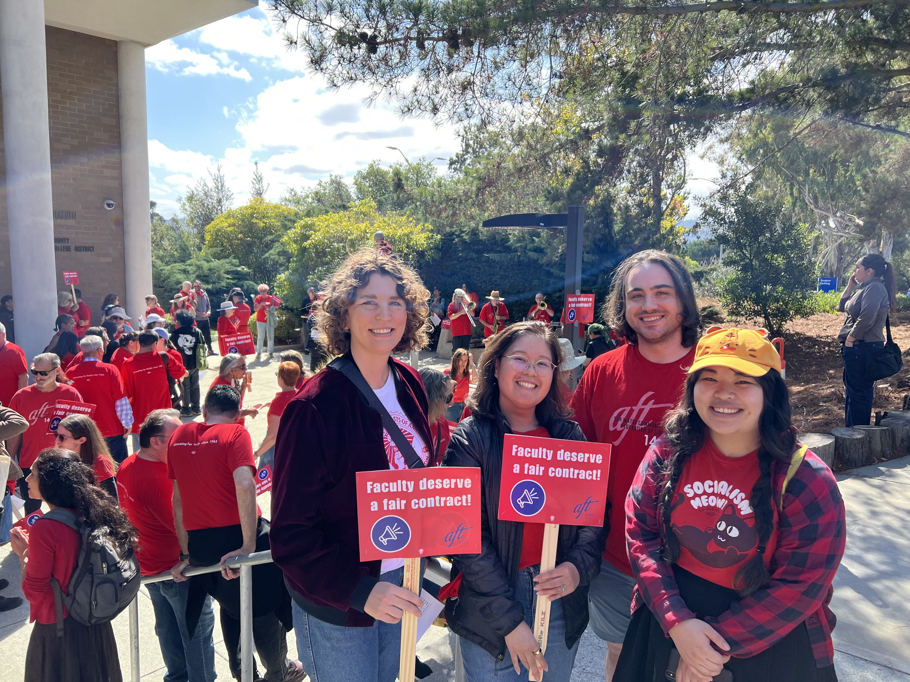

---
# config
layout: tagline
title: "Labor Working Group"
permalink: /groups/labor/
active: true
order: 10
link: true
# details
display: Labor
emoji: ':fist:'
tagline: Fighting alongside workers - on the picket line, at board meetings, and anywhere else we are needed
description: We work closely with the local labor movement --- especially [AFSCME Local 829](https://www.afscme57.org/afscme-local-829), [AFT 1493](https://aft1493.org/), and [Teamsters Local 2785](https://www.teamsters2785.org/)--- to build working class power within and through unions -- whether it’s during the organizing of their creation, contract negotiations, strike support, and any other labor activities throughout San Mateo County. Many of our members are currently in unions, are involved in organizing their workplaces, and have first hand experience in the labor movement.
discord: labor
# meetings
meetings: other
day: Monday
time: 7:00 pm
location:
---
<head>

</head>
---



### What We Do
Peninsula DSA is helping to build the power of the working class through our work supporting unions -- whether it’s during the organizing of their creation, contract negotiations, strike support, and any other labor activities throughout San Mateo County. Many of our members are currently in unions, are involved in organizing their workplaces, and have first hand experience in the labor movement. In the past, we've supported local unions such as Teamsters 2785, AFT 1493, and SEIU-USWW at SFO in their contract negotiations and strikes, as well as SBWU down in San Jose alongside our sister chapter, Silicon Valley DSA.

Currently, we are involved in training workers to organize their workplace via the Emergency Workers Organizing Committee (EWOC) and are supporting local workers who are doing so, too. Stay tuned for socialist job fairs to get workers into jobs with union backing and other initiatives as we prepare for 2028 and the general strike called for by the UAW and others.

##### _The Labor WG meets via Discord **every other Monday at 7:00 pm**_
##### [_See our chapter calendar for more details_](../events)



    

        {{ my_markdown | markdownify }}
    

    

        
    

---
### Interested in Organizing Your Workplace?

If you live or work in the Peninsula and are curious about unionization or forming a union at your workplace, please feel free to get in touch with Peninsula DSA, and the Labor Working Group will be happy to support you. We can help answer questions you have about how to organize or unionize, get in touch with unions you may like to affiliate with, provide trainings for you and your coworkers on organizing skills, or even provide material support towards your efforts.
Want DSA to Support Your Union?

### Want DSA to Support Your Union?

If you’re in a union and would like the support of the community during any negotiations or actions, please contact Peninsula DSA. We’ll be more than happy to provide any support you feel you need, brainstorm about tactics we can do from the outside, and even provide material support to you. We can also organize socialist job fairs for unions interested in finding workers to be hired into critical shops.

